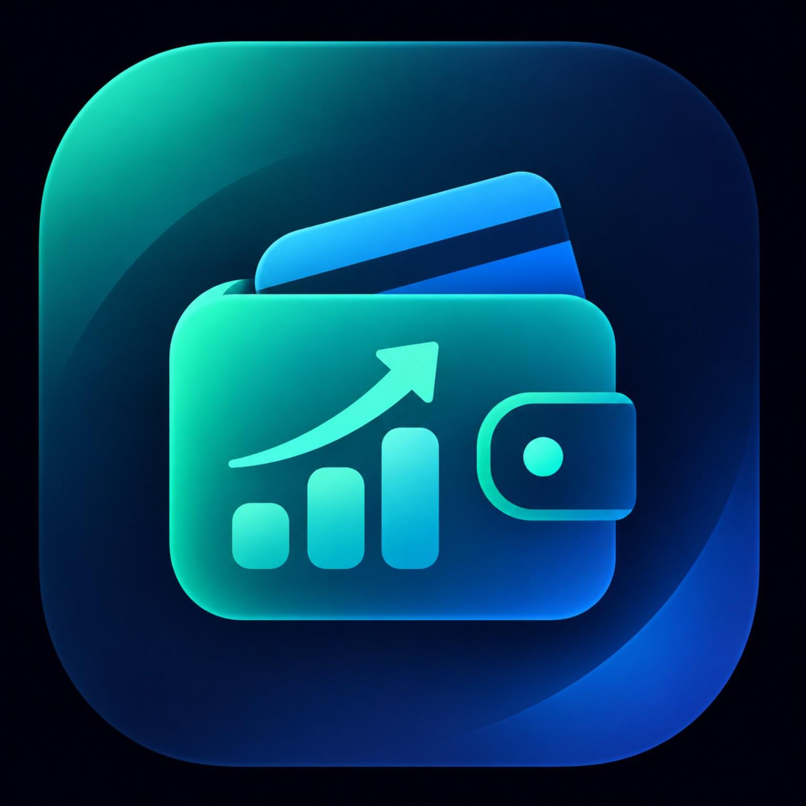

# Mis Finanzas

Una app Android nacida de una necesidad cotidiana: entender cuánto hay que pagar cuando se acumulan compras a meses sin intereses en varias tarjetas.



**Kotlin · Jetpack Compose · Material 3 · Room · WorkManager · Android 8.0+**

## El problema

Cada banco muestra sus propios saldos, fechas y mensualidades. Cuando hay varias tarjetas y planes MSI, resulta difícil responder tres preguntas en un solo lugar:

- ¿Cuánto tengo que pagar este periodo?
- ¿Cuánto debo todavía de cada compra?
- ¿Cuánto dinero ya está comprometido para los siguientes meses?

Mis Finanzas centraliza ese seguimiento y distingue el saldo a pagar, las compras posteriores al corte y la deuda pendiente de MSI. Un pago o una transferencia debe afectar los saldos una sola vez.

## Qué permite hacer

- Registrar múltiples cuentas y tarjetas, con fechas de corte y pago.
- Consultar cada compra MSI, su mensualidad, progreso, saldo pendiente y próximas fechas.
- Separar saldo del periodo, saldo actual, MSI y saldo a favor.
- Registrar ingresos, gastos, pagos, transferencias, devoluciones y bonificaciones.
- Revisar diferencias entre los planes individuales y el agregado MSI de una tarjeta.
- Administrar presupuestos, suscripciones, metas, inversiones y cuentas por cobrar.
- Interpretar notificaciones bancarias compatibles y enviarlas a una bandeja **Por confirmar**.
- Conciliar saldos manualmente y conservar un historial de ajustes.
- Crear y restaurar respaldos JSON y exportar movimientos a CSV.

## Demostración sin datos personales

Esta edición pública utiliza exclusivamente ejemplos ficticios. No incluye movimientos, saldos, ingresos, terminaciones de tarjetas, respaldos ni claves de firma de la instalación personal.

| Tarjeta ficticia | Compra original | Plazo | Pagos realizados | Mensualidad | Pendiente MSI |
|---|---:|---:|---:|---:|---:|
| Aurora Demo | $1,200 MXN | 12 meses | 2 | $100 MXN | $1,000 MXN |
| Brisa Demo | $900 MXN | 9 meses | 3 | $100 MXN | $600 MXN |
| Cobre Demo | $600 MXN | 6 meses | 3 | $100 MXN | $300 MXN |

Los importes de ejemplo son deliberadamente sencillos para comprobar los cálculos. Las fechas se generan respecto al primer arranque. Los saldos iniciales representan una fotografía ficticia; los movimientos recientes de ejemplo forman parte de ese historial y no se vuelven a aplicar sobre esos saldos.

El identificador de esta edición es `org.misfinanzas.demo`; se instala por separado. Se inicializa una sola vez y conserva los cambios del usuario. No contiene el historial Git de la edición privada.

## Cómo se construyó con IA

El proyecto se desarrolló con apoyo de ChatGPT y Codex mediante un ciclo de requisitos, implementación, pruebas y correcciones. La personalización partió de necesidades concretas de uso y continuó al probar la app en el teléfono.

1. **Definir el problema.** Convertir el seguimiento de varias tarjetas y compras MSI en requisitos: mensualidades, fechas, progreso y dinero comprometido.
2. **Diseñar la experiencia.** Definir navegación, formularios, tema oscuro y una lectura clara de saldos y planes.
3. **Construir por módulos.** Usar IA para apoyar la implementación en Kotlin, Compose y Room, incorporando funciones de manera incremental.
4. **Probar en uso cotidiano.** Revisar cálculos y flujos; detectar transferencias duplicadas, diferencias entre saldos y planes, y clasificaciones incorrectas de notificaciones.
5. **Corregir con evidencia.** Convertir los comportamientos esperados en reglas y pruebas. Por ejemplo: un pago dirigido a MSI no debe descontarse también del saldo del periodo.
6. **Validar y versionar.** Mantener pruebas, migraciones de base de datos y un flujo de compilación con GitHub Actions.
7. **Preparar la edición pública.** Sustituir datos privados por casos ficticios y eliminar firma personal, ajustes particulares e historial privado.

La IA participó en la generación y modificación del código. La definición del problema, las prioridades, las decisiones de producto y la validación del comportamiento fueron parte del trabajo del autor. La detección bancaria de la app usa reglas locales; no llama a un modelo de IA para leer notificaciones.

Más detalles en [docs/DESARROLLO_CON_IA.md](docs/DESARROLLO_CON_IA.md).

## Arquitectura

La UI en Compose consume estado de un ViewModel. El repositorio concentra las operaciones financieras y usa DAO de Room para la persistencia. WorkManager ejecuta tareas periódicas y un NotificationListenerService procesa alertas compatibles cuando el usuario concede el permiso.

Los importes se guardan como `Long` en centavos. Los pagos, transferencias y restauraciones usan transacciones de base de datos donde corresponde. La base está en versión 8 y conserva migraciones no destructivas.

## Compilar y ejecutar

Requisitos: JDK 17, Gradle 9.3.1, Android SDK 36 y Build Tools 36.0.0. El repositorio de origen no incluye Gradle Wrapper; instala esa versión de Gradle o utiliza GitHub Actions.

```bash
gradle :app:testDebugUnitTest :app:assembleDebug --stacktrace
```

También puedes abrir el proyecto en Android Studio y configurar Gradle 9.3.1 y el SDK indicado. El APK debug se genera en `app/build/outputs/apk/debug/app-debug.apk`. Android genera la firma de depuración local; una firma de distribución debe configurarse fuera del repositorio.

El workflow **Probar y compilar demo** ejecuta pruebas y genera un APK como artefacto. La edición pública debe superar ese workflow antes de presentar su APK como validado. Las validaciones estáticas no sustituyen una compilación ni pruebas en dispositivo.

## Pruebas

La suite contiene casos de cálculo de tarjetas, pagos, transferencias, edición y eliminación de movimientos, conciliación, respaldos, revisión de MSI, migraciones y notificaciones. Los casos que contenían cifras particulares fueron sustituidos por ejemplos sintéticos.

La inicialización de la demo tiene pruebas para comprobar que no reaplica sus saldos ni reemplaza datos existentes.

## Privacidad y permisos

- Los datos se procesan y guardan localmente; no se solicitan credenciales bancarias.
- El manifest no declara permiso de Internet. No hay backend bancario ni sincronización remota propia.
- La copia automática del sistema está deshabilitada en esta edición. Los respaldos y CSV manuales contienen los datos que registre quien use la app y deben compartirse conscientemente.
- El acceso a notificaciones es opcional. Los textos detectados o ignorados pueden conservarse localmente para revisión y diagnóstico.
- Los movimientos detectados requieren confirmación. No se realizan operaciones en el banco.
- Los nombres de bancos y paquetes Android en el parser son referencias técnicas de compatibilidad, no datos de clientes ni una afiliación con las instituciones.

## Alcance actual

Es un proyecto personal en evolución. La detección depende del formato de cada notificación y puede necesitar ajustes. El parser conserva nombres de cuentas por banco: para usar detecciones fuera de la demo hay que crear o seleccionar las cuentas correspondientes y revisar el destino antes de confirmar. Los bancos ficticios de la demo no generan alertas reales.

La conciliación permite registrar el desglose observado; la app no consulta al banco para comprobarlo. Conviene verificar cálculos, fechas y flujos en dispositivo antes de utilizarla como registro habitual.

Las contribuciones, propuestas y ejemplos de notificaciones deben utilizar datos ficticios. No publiques estados de cuenta, respaldos ni capturas con información personal.
